<picture>
  <source media="(prefers-color-scheme: dark)" srcset="assets/header-dark.svg">
  <source media="(prefers-color-scheme: light)" srcset="assets/header-light.svg">
  
</picture>

  <a href="https://babazadeh.dev"><picture>
    <source media="(prefers-color-scheme: dark)" srcset="assets/link-web-dark.svg">
    <source media="(prefers-color-scheme: light)" srcset="assets/link-web-light.svg">
    
  </picture></a>&nbsp;
  <a href="https://www.linkedin.com/in/moe-babazadeh/"><picture>
    <source media="(prefers-color-scheme: dark)" srcset="assets/link-linkedin-dark.svg">
    <source media="(prefers-color-scheme: light)" srcset="assets/link-linkedin-light.svg">
    
  </picture></a>&nbsp;
  <a href="mailto:moe@babazadeh.dev"><picture>
    <source media="(prefers-color-scheme: dark)" srcset="assets/link-email-dark.svg">
    <source media="(prefers-color-scheme: light)" srcset="assets/link-email-light.svg">
    
  </picture></a>

I've been building since 2007, from robots, industrial controllers and GSM weather stations still running after 15 years to web, mobile and AI platforms at early-stage and growth startups. I like owning the architecture, setting how a team builds, and keeping the engineering pointed at what the business actually needs.

Today I'm CTO at **[Neuroject](https://neuroject.com)**, leading the platform that connects BIM, schedules, budgets and risks for construction enterprises, and bringing AI into it. Before that I spent four years at **[0&1](https://0and1.co.uk)**, leading the frontend and going well past it: iOS and Android apps on both stores, firmware for attendance hardware with 200+ devices online at a single university, and the dashboards and sites around them. Almost all of it lives in private repos, so the contribution graph below says more than the repo list does.

<picture>
  <source media="(prefers-color-scheme: dark)" srcset="assets/stats-dark.svg">
  <source media="(prefers-color-scheme: light)" srcset="assets/stats-light.svg">
  
</picture>

### Work

  <a href="https://neuroject.com"><picture>
    <source media="(prefers-color-scheme: dark)" srcset="assets/card-neurobuild-dark.svg">
    <source media="(prefers-color-scheme: light)" srcset="assets/card-neurobuild-light.svg">
    
  </picture></a>

  <a href="https://smartclaim.uk"><picture>
    <source media="(prefers-color-scheme: dark)" srcset="assets/card-smartclaim-dark.svg">
    <source media="(prefers-color-scheme: light)" srcset="assets/card-smartclaim-light.svg">
    
  </picture></a>

  <a href="https://0and1.co.uk"><picture>
    <source media="(prefers-color-scheme: dark)" srcset="assets/card-0and1-dark.svg">
    <source media="(prefers-color-scheme: light)" srcset="assets/card-0and1-light.svg">
    
  </picture></a>

  <a href="https://attendum.com"><picture>
    <source media="(prefers-color-scheme: dark)" srcset="assets/card-attendum-dark.svg">
    <source media="(prefers-color-scheme: light)" srcset="assets/card-attendum-light.svg">
    
  </picture></a>

  <a href="https://active-class.com"><picture>
    <source media="(prefers-color-scheme: dark)" srcset="assets/card-active-class-dark.svg">
    <source media="(prefers-color-scheme: light)" srcset="assets/card-active-class-light.svg">
    
  </picture></a>
  <a href="https://education.guide"><picture>
    <source media="(prefers-color-scheme: dark)" srcset="assets/card-education-guide-dark.svg">
    <source media="(prefers-color-scheme: light)" srcset="assets/card-education-guide-light.svg">
    
  </picture></a>
  <a href="https://school.how"><picture>
    <source media="(prefers-color-scheme: dark)" srcset="assets/card-school-how-dark.svg">
    <source media="(prefers-color-scheme: light)" srcset="assets/card-school-how-light.svg">
    
  </picture></a>

  <a href="https://apps.apple.com/us/app/attendum/id6450669101"><picture>
    <source media="(prefers-color-scheme: dark)" srcset="assets/store-attendum-appstore-dark.svg">
    <source media="(prefers-color-scheme: light)" srcset="assets/store-attendum-appstore-light.svg">
    
  </picture></a>
  <a href="https://play.google.com/store/apps/details?id=com.attendum"><picture>
    <source media="(prefers-color-scheme: dark)" srcset="assets/store-attendum-play-dark.svg">
    <source media="(prefers-color-scheme: light)" srcset="assets/store-attendum-play-light.svg">
    
  </picture></a>
  <a href="https://apps.apple.com/us/app/education-guide/id6504922721"><picture>
    <source media="(prefers-color-scheme: dark)" srcset="assets/store-education-guide-appstore-dark.svg">
    <source media="(prefers-color-scheme: light)" srcset="assets/store-education-guide-appstore-light.svg">
    
  </picture></a>
  <a href="https://play.google.com/store/apps/details?id=guide.education"><picture>
    <source media="(prefers-color-scheme: dark)" srcset="assets/store-education-guide-play-dark.svg">
    <source media="(prefers-color-scheme: light)" srcset="assets/store-education-guide-play-light.svg">
    
  </picture></a>

Also built and live: <a href="https://user.active-class.com">Active-Class dashboard</a> · <a href="https://learningkit.com">learningkit.com</a> · <a href="https://examkit.com">examkit.com</a> · <a href="https://ukflourmillers.active-class.com">UK Flour Millers dashboard</a> · <a href="https://0and1.co.uk">0and1.co.uk</a>

### Hardware in production

  <picture>
    <source media="(prefers-color-scheme: dark)" srcset="assets/card-logger-dark.svg">
    <source media="(prefers-color-scheme: light)" srcset="assets/card-logger-light.svg">
    
  </picture>

  <picture>
    <source media="(prefers-color-scheme: dark)" srcset="assets/card-epc-dark.svg">
    <source media="(prefers-color-scheme: light)" srcset="assets/card-epc-light.svg">
    
  </picture>
  <picture>
    <source media="(prefers-color-scheme: dark)" srcset="assets/card-mini-plc-dark.svg">
    <source media="(prefers-color-scheme: light)" srcset="assets/card-mini-plc-light.svg">
    
  </picture>

### Hobby projects

  <picture>
    <source media="(prefers-color-scheme: dark)" srcset="assets/hobby-pulse-iot-dark.svg">
    <source media="(prefers-color-scheme: light)" srcset="assets/hobby-pulse-iot-light.svg">
    
  </picture>
  <picture>
    <source media="(prefers-color-scheme: dark)" srcset="assets/hobby-photo-dedup-dark.svg">
    <source media="(prefers-color-scheme: light)" srcset="assets/hobby-photo-dedup-light.svg">
    
  </picture>
  <a href="https://github.com/moeBabazadeh/matrix-keypad-freertos"><picture>
    <source media="(prefers-color-scheme: dark)" srcset="assets/hobby-matrix-keypad-dark.svg">
    <source media="(prefers-color-scheme: light)" srcset="assets/hobby-matrix-keypad-light.svg">
    
  </picture></a>

### Open source

Merged upstream into packages downloaded **300k+ times a week**:

| Project | What I changed | Why it mattered |
| :-- | :-- | :-- |
| **[gatsby](https://github.com/gatsbyjs/gatsby/pull/35657)** 2022   | Removed the deprecated `uuid@3.4.0` from `gatsby-cli` and `gatsby-plugin-sharp` | 🔒 **Security:** that version can fall back to `Math.random()`, which is unsafe for generating IDs. npm flagged it on every Gatsby install. |
| **[nanostores/persistent](https://github.com/nanostores/persistent/pull/20)** 2022   | Synced storage events only for the store's own key | 🐛 **Data loss:** opening the app in a second tab wiped users' saved data ([#14](https://github.com/nanostores/persistent/issues/14)). |
| **[react-query-kit](https://github.com/HuolalaTech/react-query-kit/pull/78)** 2026   | Opt-in `strictVariables`: typed query variables become required at the call site. +315 −42, with type tests. | 🧩 **Type safety:** a forgotten argument compiled fine and only failed at runtime ([#77](https://github.com/HuolalaTech/react-query-kit/issues/77)). |
| **[DefinitelyTyped](https://github.com/DefinitelyTyped/DefinitelyTyped/pull/72780)** 2025   | Added the optional name and category RegExp filters to the Autodesk Forge Viewer's `getPropertyHashes` | 🧩 **Type safety:** the types rejected filtered calls that Autodesk documents and the viewer supports. |
| **[gatsby-plugin-react-i18next](https://github.com/microapps/gatsby-plugin-react-i18next/pull/93)** 2021   | Added `forwardRef` support to the localized `Link` | 🐛 **Bug:** refs passed to localized links were silently dropped ([#74](https://github.com/microapps/gatsby-plugin-react-i18next/issues/74)). |

Plus bug reports upstream to Microsoft's <a href="https://github.com/OfficeDev/office-js/issues?q=is%3Aissue%20author%3AmoeBabazadeh">office-js</a> from building PowerPoint add-ins, and to Nordic's <a href="https://github.com/nordicsemi/Android-nRF-Connect-Device-Manager/issues?q=is%3Aissue%20author%3AmoeBabazadeh">nRF Connect Device Manager</a> from the beacon work.

### Journey

<picture>
  <source media="(prefers-color-scheme: dark)" srcset="assets/journey-dark.svg">
  <source media="(prefers-color-scheme: light)" srcset="assets/journey-light.svg">
  
</picture>

**Roots in robotics and control**

- 🤖 **RoboCup:** 1st place in the Deminer Technical Challenge at IranOpen 2010, a five-robot Small Size League soccer team (2009–2011), and technical committee member at IranOpen 2013 and 2014 and AUTCUP 2013.
- 🥉 **Bronze medal** in Mobile Robotics at the 11th National Skills Competitions (2010), and a pipe-inspection crawler robot with a swivelling camera and a 200 m umbilical.
- 🎓 **BSc Electrical Engineering, Control Systems** (thesis: a two-wheel self-balancing robot with real-time fuzzy control) and **MSc Nanotechnology**, University of Tabriz.
- 📄 **Paper:** [Design, Engineering and Optimization of a Grid-Tie Multicell Inverter for Energy Storage Applications](https://arxiv.org/abs/1708.08008) (arXiv, 2017).

### Toolbox

  <picture>
    <source media="(prefers-color-scheme: dark)" srcset="https://skillicons.dev/icons?i=ts%2Creact%2Cnextjs%2Credux%2Cmaterialui%2Csvelte%2Ctailwind%2Cvite%2Cfirebase%2Cgatsby%2Cphp%2Claravel%2Cpy%2Cfastapi%2Cpostgres%2Cmysql%2Caws%2Cdocker%2Cgithubactions%2Clinux%2Cswift%2Cc&perline=11&theme=dark">
    <source media="(prefers-color-scheme: light)" srcset="https://skillicons.dev/icons?i=ts%2Creact%2Cnextjs%2Credux%2Cmaterialui%2Csvelte%2Ctailwind%2Cvite%2Cfirebase%2Cgatsby%2Cphp%2Claravel%2Cpy%2Cfastapi%2Cpostgres%2Cmysql%2Caws%2Cdocker%2Cgithubactions%2Clinux%2Cswift%2Cc&perline=11&theme=light">
    
  </picture>

Also: Expo / React Native · Preact · Office.js add-ins · STM microcontrollers · ESP-IDF · Zephyr / nRF Connect SDK · GSM telemetry · BLE · NFC / RFID · Laravel Vapor · AWS Amplify · Autodesk APS · AG Grid · OpenAI · pgvector · SwiftUI + Vision · FreeRTOS
